<p align="center">
  <a href="https://github.com/bubb4rd/pervigil"></a>
</p>

<h1 align="center">Pervigil</h1>

<p align="center">
  <a href="https://github.com/bubb4rd/pervigil/actions/workflows/ci.yml"></a>
  
  
  
  <a href="LICENSE"></a>
</p>

<p align="center">A native macOS menu bar utility that keeps your Mac awake while work is running and lets it sleep when idle.</p>

<p align="center">
  <a href="#install">Install</a> ·
  <a href="#features">Features</a> ·
  <a href="#automation">Automation</a> ·
  <a href="#permissions">Permissions</a> ·
  <a href="#build-from-source">Build</a>
</p>

<p align="center">
  
</p>

Pervigil manages macOS `IOPMAssertion` power assertions manually or automatically through configurable triggers, closed-display controls, and CLI/MCP leases. It is distributed outside the Mac App Store because the App Sandbox blocks `IOPMAssertion` APIs.

> [!NOTE]
> Pervigil is an unofficial fork of [Keepresso](https://github.com/gyorgysh/keepresso) and is not affiliated with or endorsed by the Keepresso project or pueev OÜ. See [TRADEMARK.md](TRADEMARK.md).

## Install

Requires macOS 14 (Sonoma) or later.

```sh
brew install --cask bubb4rd/pervigil/pervigil
```

Or download the signed, notarized DMG from [Releases](https://github.com/bubb4rd/pervigil/releases) and move **Pervigil** to Applications.

Updates are delivered via [Sparkle](https://sparkle-project.org) (see [CHANGELOG.md](CHANGELOG.md)). To uninstall, remove the optional administrator helper in **Preferences → General**, then quit the app and run `brew uninstall --cask pervigil` (add `--zap` to clear preferences and caches).

## Features

- **Keep-awake sessions**: Independent system and display sleep assertions, preset or custom durations, "until HH:MM" end times, screen saver yield, automatic display dimming, optional idle activity simulation, and a global hotkey.
- **Automatic triggers**: Combine conditions with AND/OR logic or apply built-in presets across power, external displays, schedules, Wi-Fi, VPN, network throughput, Bluetooth, game controllers, mounted volumes, running or frontmost apps, camera/mic in-use state, audio playback, Calendar events, CPU usage, downloads, and games.
- **AI agent awareness**: Detects active coding agents (Claude Code, Cursor, Codex, Antigravity, Gemini, Aider, Devin, and others) via opt-in integrations, transcripts, or CPU baselines. Automatically wakes the Mac ahead of scheduled local AI runs.
- **Closed-display mode**: Keeps the Mac running with the lid shut on AC or battery, with session-scoped restoration, optional Low Power Mode, minimum fan floor, built-in speaker mute, and Keychain-backed hotspot fallback.
- **Safety and recovery**: Battery-threshold auto-pause, thermal protection with automatic fan boost, session reminders, scheduled wake, and end-of-session actions (sleep, lock, Shortcuts, webhooks, or shell commands).
- **System utilities**: Live power assertion inspector (`pmset` view and session log), AWDL jitter pause for gaming and streaming, Keyboard Cleaner, captive-portal Wi-Fi recovery, Headless Setup checklist, experimental HiDPI virtual display, and external drive keep-alive.
- **Native integration**: Swift/SwiftUI with no Dock icon, Widgets and Control Center support, customizable menu layouts, JSON settings import/export, and 15 languages.

## Automation

### CLI and leases

The `pervigil` CLI is linked by Homebrew or available at `/Applications/Pervigil.app/Contents/Helpers/pervigil`.

```sh
# Control the running app
pervigil start --for 90
pervigil stop
pervigil status --json          # exit 0 awake, 1 idle, 2 app not running

# Standalone assertions (work without the app running)
pervigil -t 3600                # hold for 1 hour
pervigil -w $!                  # hold until a process exits

# Bounded leases for scripts and background tools
ID=$(uuidgen)
pervigil lease acquire --id "$ID" --tool render --task "export" --ttl 600
pervigil lease heartbeat --id "$ID"
pervigil lease release --id "$ID"
```

### MCP, Shortcuts, and URL scheme

- **MCP server**: Point MCP-compatible agents at `/Applications/Pervigil.app/Contents/Helpers/pervigil-mcp` (a ready-to-install skill is bundled at `Contents/Resources/AgentSkill/keep-awake`).
- **Shortcuts**: Native Start, Stop, and Toggle Keep Awake actions for Shortcuts, Spotlight, and Siri.
- **URL scheme**: `pervigil://start`, `pervigil://start?duration=60`, `pervigil://start?until=18:00`, `pervigil://stop`, and `pervigil://toggle`.

## Permissions

Permissions are requested only when you enable a feature that requires them. Camera and microphone permissions are never requested; in-use triggers read only the system indicator state.

| Permission | Required for |
|---|---|
| **Administrator helper** | Closed-display mode, AWDL pause, fan control, wake schedules, Keyboard Cleaner, game priority, DNS flush (one-time Login Items approval, or per-launch prompt) |
| **Location** | Wi-Fi SSID trigger and hotspot fallback (required by macOS to read network names) |
| **Bluetooth** | Connected Bluetooth device trigger |
| **Calendar** | Active calendar event trigger |
| **Accessibility** | Optional keyboard/mouse methods for idle activity simulation |

## Build from source

Requires macOS 14+, Xcode 26+, and [XcodeGen](https://github.com/yonaskolb/XcodeGen) (`brew install xcodegen`). The Xcode project is generated from [`project.yml`](project.yml).

```sh
git clone https://github.com/bubb4rd/pervigil.git
cd pervigil
./scripts/run.sh                # generate Pervigil.xcodeproj and open in Xcode
swift test                      # run PervigilCore tests (requires full Xcode)
```

Documentation: [`docs/BUILDING.md`](docs/BUILDING.md) · [`AGENTS.md`](AGENTS.md) · [`docs/AUTOMATION_SYNC.md`](docs/AUTOMATION_SYNC.md) · [`CONTRIBUTING.md`](CONTRIBUTING.md) · [`SECURITY.md`](SECURITY.md)

## License

[GNU GPL v3.0](LICENSE) © 2026 Pervigil and Keepresso contributors. Forked from [Keepresso](https://github.com/gyorgysh/keepresso); the Keepresso name, logo, and app icon belong to pueev OÜ. Built with [Sparkle](https://sparkle-project.org) and [XcodeGen](https://github.com/yonaskolb/XcodeGen).
